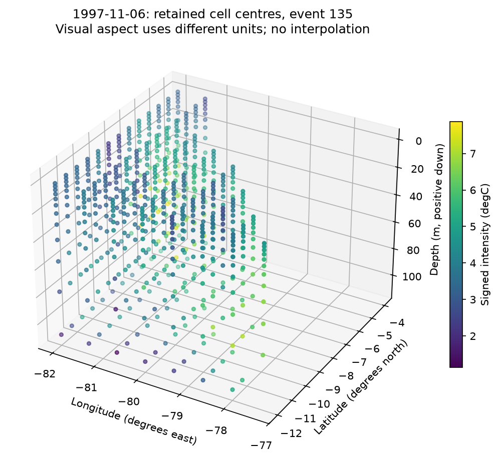
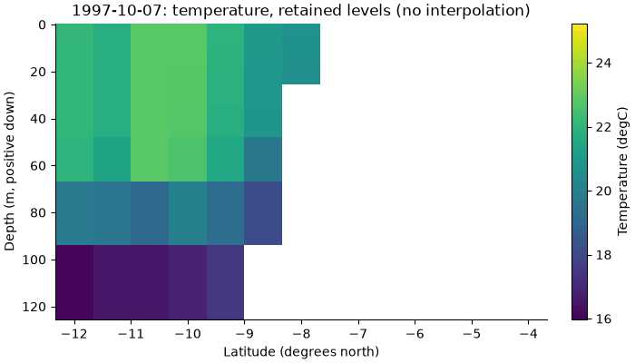

# Plotting and exploration

## GIF, 3-D and live notebook exploration

The helpers in [plotting.py](../examples/plotting.py) and
[exploration.py](../examples/exploration.py) are local example code,
not xhw plotting API. Install `python -m pip install -r examples/requirements-interactive.txt`.
The public synthetic tutorial produces evolution.gif with the known split and merge.
The six real-data notebooks have product/date/layer, event/branch and cell controls;
GLORYS adds retained-depth selection, rotatable voxel centres, offline volume.html and
vertical_evolution.gif. The view uses retained cells and explicit dates, without interpolation.

Controls operate on computed products. A disabled event selector indicates a temporal-only
product. GitHub shows the saved static figures; kernel controls require a live Jupyter
environment. Install ipywidgets in the kernel environment (and jupyterlab_widgets in a
separate Lab server environment, if used). Standalone HTML embeds Plotly and works offline.
Large HTML/NetCDF outputs remain local release assets; they are not added to Git.

The default animation selects at most 60 consecutive dates around the chosen event's
size peak. Scales are fixed within an animation. The 3-D display uses longitude/latitude
in degrees and depth in metres, positive down; its visual aspect is not a physical scale.
Decimated GLORYS levels and approximate thickness remain approximation limits.

Map helpers use declared physical coordinates, including auxiliaries; index axes are
labelled as indices. Sequence figures support one date and singleton spatial axes.
vertical_figure accepts date, variable, longitude_index and depth_slice keyword arguments.

The cell-series panel follows the selected map date, showing up to 60 days and
a dotted marker for that date. Graph size/intensity curves describe the selected
event or branch; they do not refit any temporal or spatial product. Joint TX+TN
products show the first temperature component explicitly; their combined
membership remains the joint detector output.

For installation, product formats and execution requirements, see
[Reproducibility](REPRODUCIBILITY.md).

*The largest volume-time event, at a date in its 60-day peak-size window.
Points are retained voxel centres, coloured by signed temperature difference.
Longitude/latitude use degrees and depth uses metres, positive down. The visual
aspect uses different units and is not a common physical scale; no geometry is
reconstructed between decimated cells. The notebook provides rotation and zoom.*

*The same event window, three frames per second, at the middle retained longitude.
Temperature uses the displayed field units and one fixed colour scale throughout.
Latitude is in degrees and depth in metres. Bands represent retained levels;
they do not restore the discarded layers or exact native interfaces.*

Run `python examples/glorys_volume.py --data-dir data --output-dir outputs/glorys`.
Open the generated `volume.html` locally for Play/Pause and its date slider; the
HTML embeds Plotly, so the exported scene needs no network. GitHub shows the
PNG and GIF here; it does not execute the live notebook controls.
