# Real-data tutorials

[Index](../README.md) · [Data](DATA.md)

Each case below reads the compressed datasets of `data/` (see the [README](../README.md)), verifies
them by content hash and runs every xHW stage. The notebooks contain **executed static figures and
tables**, so they can be read on GitHub without the data. Their paired scripts perform the same
analysis, and each reproduces its recorded metrics exactly (integers identical, floats at relative
1e-12). For the synthetic tutorials that need no data, see the
[xHW tutorials](https://github.com/DanielCamarena/xhw/blob/main/docs/TUTORIALS.md).

```bash
python -m pip install -r examples/requirements-interactive.txt
python examples/fetch_data.py --release-url <release url>
```

| Case | Executed notebook | Paired script | Result |
|---|---|---|---|
| OISST Peru | [oisst_peru.ipynb](../examples/oisst_peru.ipynb) | [oisst_peru.py](../examples/oisst_peru.py) | MHW/MCS, fixed/detrended, temporal and spatial events |
| OSTIA vs OISST | [ostia_peru.ipynb](../examples/ostia_peru.ipynb) | [ostia_peru.py](../examples/ostia_peru.py) | Product and resolution effects in three arms |
| OISST equatorial Pacific | [oisst_equatorial.ipynb](../examples/oisst_equatorial.ipynb) | [oisst_equatorial.py](../examples/oisst_equatorial.py) | 8 000 ocean cells: MHW/MCS, fixed versus detrended baseline, and the El Niño of 2015–16 as one large object with its genealogy |
| OISST North Pacific | [oisst_npacific.ipynb](../examples/oisst_npacific.ipynb) | [oisst_npacific.py](../examples/oisst_npacific.py) | Larger domain, the 2012–2018 Blob window and an absolute area filter; separate registered personal input |
| ERA5 Peru | [era5_peru.ipynb](../examples/era5_peru.ipynb) | [era5_peru.py](../examples/era5_peru.py) | Hourly aggregation, TX90/TN90 and joint profiles over land/ocean |
| GLORYS volume | [glorys_volume.ipynb](../examples/glorys_volume.ipynb) | [glorys_volume.py](../examples/glorys_volume.py) | Voxel detection, physical vertical connectivity and volumetric genealogy |

The results below describe the registered datasets and explicit configurations. Plotting is done with xarray and
Matplotlib; xHW has no native plotting API.

## OISST

```bash
python examples/oisst_peru.py --data-dir data --output-dir outputs/oisst
```

Input is the registered NOAA OISST v2.1 AVHRR-only final Peru subset, 1991–2025,
32 × 20 cells; reference 1991–2020. Ocean support has 349 cells with at least one
finite observation; weights use spherical 0.25° cell areas. Limited interpolation
is explicit (two days, maximum fraction 0.05); no day is filled in this input.
Marine configuration: 11-day pooling, 31-day smoothing, type 7, interpolated leap
day, sample minimum 264, no within-reference correction, five-day minimum,
two-day temporal gap, qualifying before joining, missing-as-non-exceedance.

| Temporal output | Per-cell events | Member cell-days | Maximum cell duration |
|---|---:|---:|---:|
| Fixed MHW, strict upper P90 | 16,702 | 422,215 | 412 days |
| Fixed MCS, strict lower P10 | 27,003 | 402,450 | 311 days |
| Detrended MHW, same definition | 16,765 | 433,288 | 410 days |

The detrended method uses degree-1 trend and three harmonics, fitted retrospectively.
Membership Jaccard is approximately 0.9163: intersection/union on jointly valid
cell-days, without area weighting. This is a comparison of definitions of reference,
not a ranking of physical validity. The frequency maps use occupied valid days
divided by valid days at each cell.

Spatial recipe: event membership → face patches at least 5% of ocean area →
tracking with any positive smaller-object overlap, no object gaps and minimum
five days. The object table has 2,956 daily patches, 118 retained tracks. Genealogy
has 279 branches, 136 spacetime components, 38 split nodes and 41 merge nodes.
The largest area-time component is event 26, with 435 calendar days. These are
different counts from the per-cell catalog.

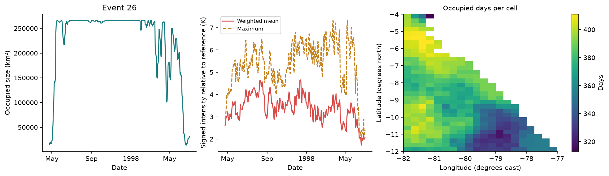

*Area in km², signed area-weighted intensity in K relative to reference, and occupied
days per cell for event 26. Selection and recipe are stated above. The map describes
this event's footprint history, not an annual climatology. Spatial interpretation
and dynamic summaries are pending scientific review; the temporal reference has
prior approval.*

The graph contains 18 components shorter than five days whose patch labels are
retained but track IDs filtered. The qualified EventCatalog export rejects
them; the tutorial records that constraint and uses the valid graph's tables,
series and maps. See [the export constraint](https://github.com/DanielCamarena/xhw/blob/main/docs/OBJECTS.md#catalog-export-qualification).
Six figures cover temperature/masks, baseline comparison, label/track sequence,
genealogy and metrics. Real branch diagrams explicitly mark when only the first
18 branches are displayed.


## OSTIA versus OISST

```bash
python examples/ostia_peru.py --data-dir data --output-dir outputs/ostia
```

Runs the same marine heatwave analysis in three arms on one 32 × 20 box (12°S–4°S, 82°W–77°W,
1991–2025) so that two effects that a plain comparison mixes can be told apart:

| Arm | Data | Cells |
|---|---|---|
| OISST | NOAA OISST v2.1 at 0.25° | 349 ocean |
| OSTIA 0.25° | OSTIA averaged over the 5 × 5 sub-cells of each OISST cell (at least 13 of 25 must be ocean) | 346 ocean |
| OSTIA 0.05° | OSTIA at its native resolution | 8 601 ocean |

The **product effect** is OISST against OSTIA 0.25°; the **resolution effect** is OSTIA 0.25°
against OSTIA 0.05°. Every arm uses the same marine definition (P90, five days, two-day gaps,
qualify then join), the same fixed 1991–2020 climatology and the same spatial recipe (face patches
of at least 5% of the ocean area, tracking by any shared cell, five-day tracks). OSTIA is decoded
from its stored integers as exact hundredths of a degree, and OISST and OSTIA are matched by
calendar day because their timestamps differ (12:00 and 00:00).

| | OISST | OSTIA 0.25° | OSTIA 0.05° |
|---|---|---|---|
| Per-cell events | 16 702 | 14 536 | 371 109 |
| Events per ocean cell | 47.9 | 42.0 | 43.1 |
| % of valid days in an MHW | 9.46 | 9.60 | 9.52 |
| Daily patches with the 5% area filter | 2 956 | 2 729 | 2 666 |
| Daily patches without a filter | 8 251 | 14 510 | 31 343 |
| Tracks / spacetime events | 118 / 136 | 96 / 123 | 88 / 105 |
| Run time | 8 s | 10 s | 740 s |

The OISST arm reproduces the registered OISST case (16 702 events, 118 tracks).

- **Product effect.** On the 345 cells that are ocean in both, OSTIA is 0.30 °C colder on average
  (RMSE 0.83 °C, correlation 0.966). Event membership overlaps with a Jaccard index of 0.64, and
  the cell-by-cell frequency maps differ with an RMSE of 0.37 percentage points and a correlation
  of 0.47.
- **Resolution effect.** Pooling the 0.05° events back onto the 0.25° cells gives frequency maps
  that differ from OSTIA 0.25° with an RMSE of 0.13 percentage points and a correlation of 0.94:
  almost three times smaller than the product effect. The yearly domain frequency agrees closely
  (r = 0.99996 between the two OSTIA arms; r = 0.987 between OISST and OSTIA).
- **Fragmentation.** With the 5% area filter the daily patch counts nearly agree (2 729 against
  2 666); without it the native grid yields 31 343 components, 3.8 times the OISST count.
- **Cost.** 25 times more cells took about 90 times longer; the native arm is 93% of the 13 minutes.

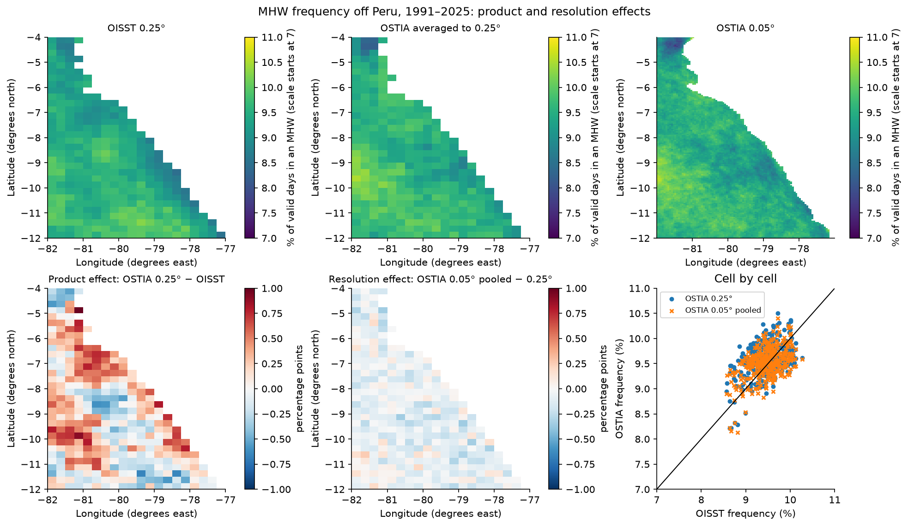

*Top: percentage of valid days inside an MHW (the colour scale starts at 7%, not zero). Bottom left:
product effect, OSTIA 0.25° minus OISST. Bottom middle: resolution effect, OSTIA 0.05° pooled
minus OSTIA 0.25°; both difference maps share one scale. Bottom right: cell by cell.*

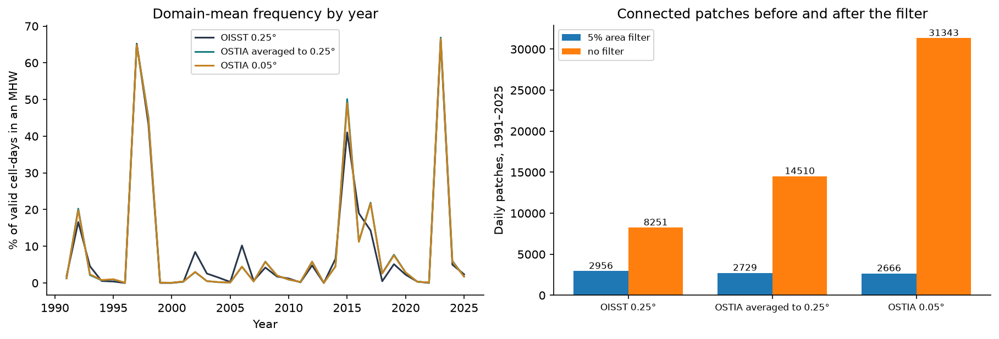

*Left: domain frequency by year. OISST is higher in 2002, 2006 and 2016 and lower in 2015.
Right: connected daily patches with and without the area filter.*

These are reproduced numbers, pending scientific review. It was not investigated why the two
products differ, nor how each behaves close to the coast.

## OISST equatorial Pacific

```bash
python examples/oisst_equatorial.py --data-dir data --output-dir outputs/equatorial
```

The same analysis as the Peru case over the box of the Niño 3.4 index: NOAA OISST over 5°S–5°N and
170°W–120°W (40 × 200 cells at 0.25°, all ocean, longitudes −170° to −120°), 1991–2025, reference
1991–2020 and the same marine definition. It is a region where the strong El Niños of 1997–98 and
2015–16 and the event of 2023 are the dominant signal, and it takes about 9 minutes on the test
machine. Because the box is small, the whole period gets a per-cell catalog, objects and genealogy.

| Output | Value |
|---|---:|
| Valid cell-days | 102 272 000 |
| MHW per-cell events / per ocean cell | 376 186 / 47.0 |
| MHW event cell-days / share of valid days | 8 688 894 / 8.50% |
| MCS per-cell events / per ocean cell | 579 809 / 72.5 |
| MCS event cell-days / share of valid days | 7 836 939 / 7.66% |
| Longest per-cell event: MHW / MCS | 378 days / 291 days |
| Detrended MHW events / event cell-days | 374 470 / 8 682 567 |
| Fixed versus detrended Jaccard (jointly valid cell-days) | 0.932 |
| Daily patches / retained tracks | 2 380 / 58 |
| Branches / spacetime components | 288 / 82 |
| Split nodes / merge nodes | 63 / 55 |

The largest component by area-time is event 55: 418 days from about April 2015, growing to cover
practically the whole box (up to 6.17 million km², the area of the box itself) between September 2015
and March 2016, with an area-weighted intensity of about 3 K and a cell maximum above 5 K at the
peak. A single track (42 in the sequence below) holds the patch through the whole El Niño. The graph
also holds 24 components shorter than five days, so the qualified `EventCatalog` export rejects them:
the catalog qualification constraint described in
[Objects](https://github.com/DanielCamarena/xhw/blob/main/docs/OBJECTS.md#catalog-export-qualification).

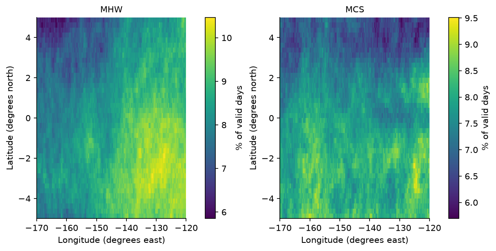

*Percentage of valid days inside an event, 1991–2025; each panel has its own colour scale. Both
frequencies are lowest at the northern edge of the box (about 6%).*

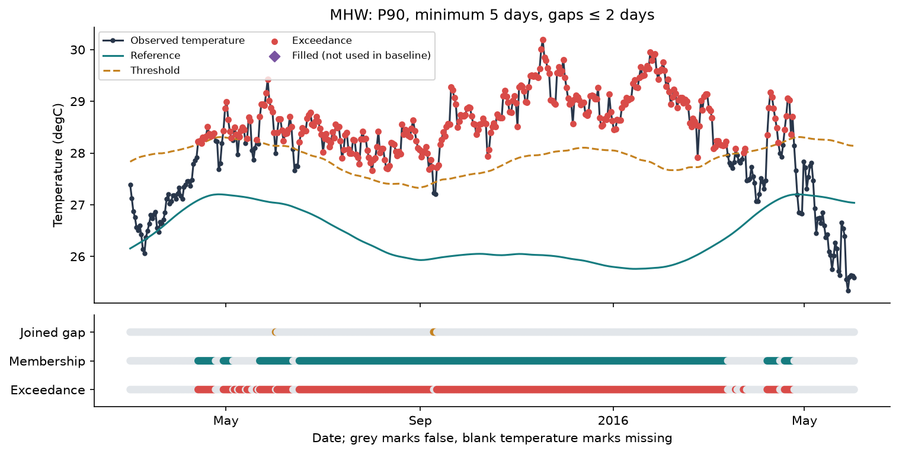

*Temperature, reference and threshold at one cell (about 0°, 145°W), with the exceedance, joined-gap and
membership layers underneath: a single marine heatwave of about a year.*

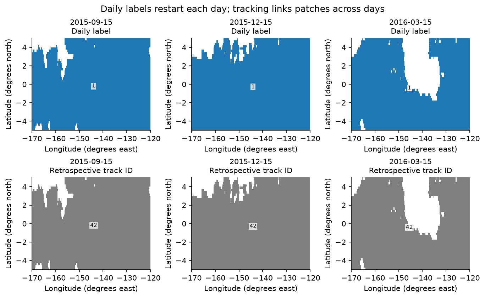

*The face-connected patch on three dates. One patch covers almost the whole box in September and
December 2015 and still most of it in March 2016, when a gap opens in the east-centre; its track ID
is the same on all three dates.*

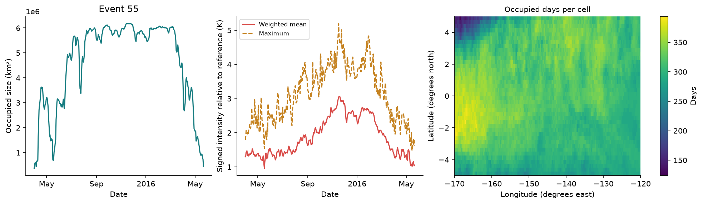

*Occupied area, area-weighted signed intensity and occupied days per cell of the 2015–16 event.*

These are reproduced numbers, pending scientific review. A marine heatwave defined from a fixed
1991–2020 percentile is not an El Niño index: the tutorial shows how the objects respond to a very
large, coherent warming and does not diagnose ENSO.

## North Pacific OISST

This larger case needs the separately registered personal dataset
`oisst_npacific_1991_2025.nc` (445 MB), described in
[its manifest](../examples/sources/oisst_npacific.json). It is not included in
`fetch_data.py` or the standard `data-v1` assets. Supply that registered file in
`--data-dir`; the analysis does not download or substitute another dataset.

```bash
python examples/oisst_npacific.py --data-dir data --output-dir outputs/npacific
```

The 120 × 280 grid spans 25–55°N and 160–230°E, crossing the dateline without
reordering longitude. Detection covers 1991–2025, reference 1991–2020, with the
same fixed marine settings as Peru. Catalog, objects and genealogy are limited
to 2012–2018, reusing that fitted baseline. This bounds the catalog population;
it does not change the detection reference or claim to track the whole period.

Face-connected membership patches use an absolute 10,000 km² minimum, followed
by positive overlap, no object gaps and a five-day tracker filter. The default
5% domain filter would discard nearly all small patches here. Daily patches,
tracker identities and graph components remain different populations. See the
[executed run record](run_records/oisst_npacific.json) for their counts and
the qualified-catalog export constraint. The interactive notebook adds product,
date, event, branch, layer and cell controls over these computed products.

Full-period float64 arrays make this a memory-intensive example: one
time-by-cell float64 array is about 3.4 GB, before masks and working arrays.
The temporal stages therefore process four latitude rows at a time, keeping
every date of each cell. Interpolation quality fractions are computed over the
whole original interval, including the context outside the object window.
Only the prepared 2012–2018 window is assembled globally for segmentation and
tracking; spatial objects are never built independently per block. The paired
script exports full-period flag masks by latitude block and two combined DOY
baselines, followed by the global window products. Files retain physical
latitude coordinates; their manifest identifies each block. This changes storage
and memory use, while retaining the input dtype and scientific selections.

Run it separately from other large cases. A dynamic fit is deliberately absent;
its four full fields alone would require about 14 GB. The notebook's static
figures remain readable without the data. All summaries await scientific review.

## ERA5

```bash
python examples/era5_peru.py --data-dir data --output-dir outputs/era5
```

Use the registered daily ERA5 Peru file, 1991–2025, plus the registered 2023 hourly
file for a four-day demonstration. Reference is 1991–2020. The 33 × 21 surface
has 323 land and 370 ocean-air cells, split by lsm ≥0.5/<0.5. Units are K and
weights are spherical 0.25° areas. Neither domain represents seawater temperature.

The hourly demonstration selects March 1–4, 2023 UTC. `aggregate_daily` takes max
mx2t/min mn2t as period-ending samples, with UTC input and `offset:-05:00` output
days. All 24 hourly samples are required; boundary days are incomplete and NaN.
Three interior daily fields match registered TX/TN with **0 K maximum absolute
difference**. Maximum sampled t2m is plotted only as a contrast.

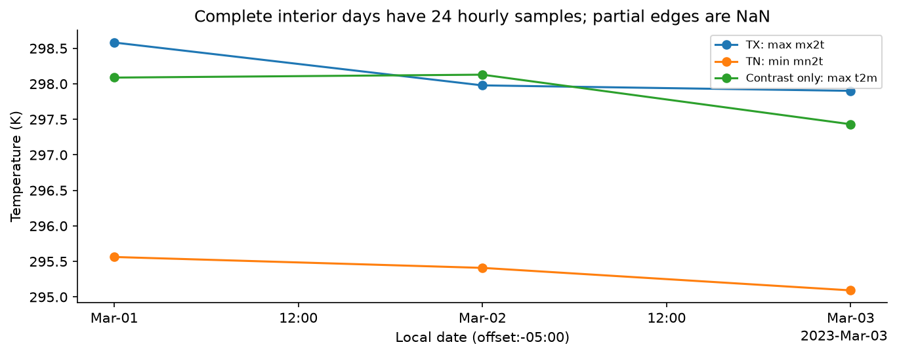

*A selected cell, local UTC−05:00 date, K. TX/TN are daily extrema of period-ending
mx2t/mn2t; t2m uses instantaneous samples. The accompanying notebook table shows
sample counts. These streams need not bound each other.*

Profiles use P90, 15-day pooling, type 8, no smoothing, `min_samples=360`, no
in-base correction, strict comparison, minimum three days and no temporal gap.
TX+TN combines **daily** exceedances before persistence. Lag 0 tests the same day;
lag 1 uses TX on D and TN on D+1, so the last day loses valid component context.

| Profile | Per-cell land events | Per-cell ocean-air events |
|---|---:|---:|
| TX90 | 43,506 | 28,552 |
| TN90 | 41,252 | 29,955 |
| TX+TN lag 0 | 8,921 | 24,155 |
| TX+TN lag 1 | 9,941 | 23,262 |

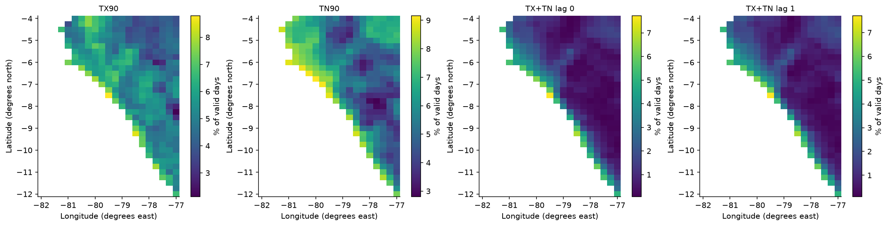

*Percentage of valid days belonging to each AHW profile on land, 1991–2025.
Domains outside land are blank. Each panel has its own color scale. Counts and
maps are reproduced summaries pending scientific review; they do not establish
causes or equivalence to an annual percentage index. The ocean-air companion
figure and all profile parameters are saved in the notebook/report.*


## GLORYS

```bash
python examples/glorys_volume.py --data-dir data --output-dir outputs/glorys
```

Use the registered 31 annual GLORYS12V1 thetao files, 1993–2023; reference
1993–2022. GLORYS is an assimilating **reanalysis**, not a direct observation.
Selection preserves every eighth horizontal cell and original depth indices
0,2,…,22: 13 × 8 horizontal centres, 12 retained depths, 0.5 to about 110 m.
The original download extends deeper; only these retained levels are analysed.

Spherical coarse-cell areas use 2/3° spacing. Interfaces halfway between retained
depths approximate thickness, with top at zero and extended bottom half-spacing.
This yields approximately 37,631.38 km³ of declared ocean volume. These are
approximate retained-cell measures, not the original model's exact layer bounds.
Decimation may miss structures, change topology and bias integrated quantities;
no conservative remapping or high-resolution claim is made.

No gap interpolation is performed. Marine P90/five-day/two-gap settings use
11-day pooling, 31-day smoothing, type 7, sample minimum 264 and no in-base
correction. Daily connected voxel counts depend on the neighbourhood:

| Vertical gap limit, rank 1 | Daily patches |
|---|---:|
| Index / 0 m: adjacent faces | 25,649 |
| Physical intervening gap ≤5 m | 25,561 |
| Physical intervening gap ≤20 m | 24,759 |

Tracking uses six-face index patches without a volume cut, smaller-object
volume overlap ≥0.1, no object gaps and minimum five days. The graph uses
volume-weighted intensity and has 1,041 spacetime events, 4,968 branches,
1,007 split nodes and 994 merge nodes. Its qualified catalog export passes checks.
On 2023-05-15 the occupied fraction is about 0.71975 of the declared volume.
The per-voxel temporal catalog has 29,597 events; that is a different population.

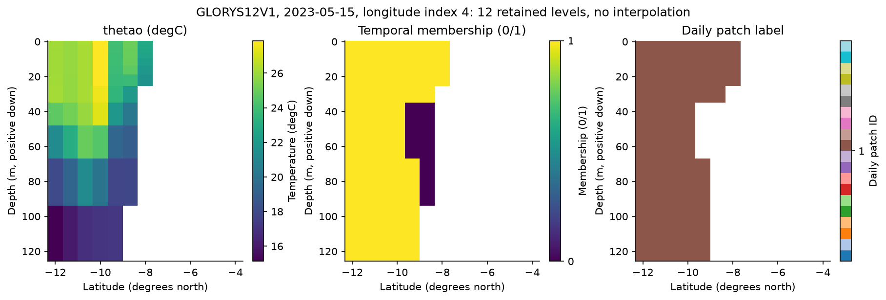

*2023-05-15 at the middle retained longitude, with 12 retained levels and positive-down
depth in metres. Temperature (°C), temporal membership (0/1) and daily patch labels
show three representations of the same section. No vertical interpolation is
performed. The labels come from 3-D connectivity, not separate 2-D section labelling.*

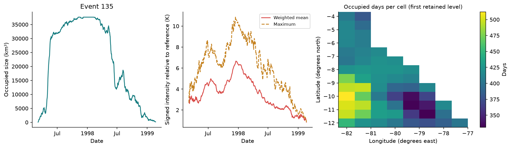

*Largest volume-time component: occupied size in km³, volume-weighted signed mean
and maximum intensity in K, and occupied days at the first retained depth. The
map is a slice, not total volume. All real volumetric/genealogy summaries remain
pending scientific review. Five figures include frequency, label/track sequence,
section, branch genealogy and metrics.*


## Re-run notebooks and compare formats

```bash
python examples/execute_notebooks.py --data-dir data --output-dir outputs/notebooks
```

The runner uses its own Python installation for a **fresh kernel per notebook**,
validates nbformat, executes all cells with nbclient, writes actual outputs in place
and records timings. It overwrites saved notebook outputs; work in a checkout.
`--case oisst|ostia|equatorial|npacific|era5|glorys` selects one; running all six
also requires the separate North Pacific input. See [Reproducibility](REPRODUCIBILITY.md) for environments, memory requirements,
product checks and scientific-review limits. Each run records its actual software
versions and source fingerprints.
